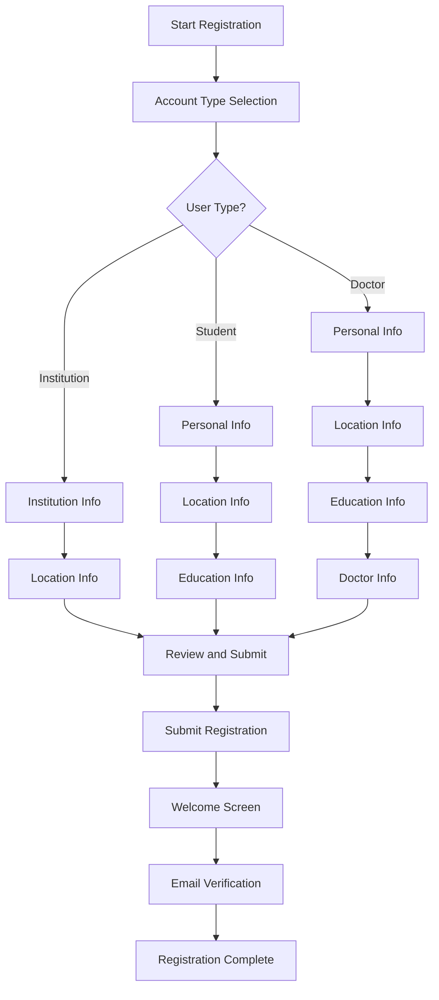

# Web Registration Enhancement Plan

## Overview
Enhance the web registration process to match the mobile app's multi-step registration flow, providing a consistent user experience across platforms.

## Current State Analysis

### Mobile App Registration Flow
The mobile app has a comprehensive multi-step registration with dynamic steps based on user type:

1. **Account Type Selection** - Choose between Student, Doctor, or Institution
2. **Personal Info** - Name, username, phone, birthdate (different fields for institution)
3. **Location Info** - City, address, nationality, passport image upload
4. **Education Info** - University name, current degree (for doctor/student only)
5. **Doctor Info** - Membership number, branch selection (for doctors only)
6. **Review & Submit** - Summary of all entered data
7. **Welcome** - Success screen after registration

### Current Web Registration Flow
The web has a simpler 5-step flow:

1. **Account Type** - Radio button selection
2. **Personal Info** - Basic fields
3. **Location** - City, address
4. **Education** - Basic fields
5. **Review** - Simple review

### Key Differences
- Web missing Doctor Info step (membership number, branch)
- Web missing Welcome success screen
- Web missing passport image upload
- Web missing dynamic step flow based on user type
- Web has simpler UI for account type selection

## Implementation Plan

### Phase 1: Data Model Updates

#### 1.1 Update RegisterData Interface
File: `frontend/src/api/auth.ts`

Add missing fields:
```typescript
export interface RegisterData {
  username: string;
  email: string;
  password: string;
  full_name: string;
  phone_number?: string;
  user_type: 'doctor' | 'student' | 'institution';
  birthdate?: string;
  city?: string;
  address?: string;
  nationality?: string;
  passport_image?: File | string;  // NEW: File upload
  university_name?: string;
  current_degree?: string;
  specialty?: string;
  bio?: string;
  branches?: number[];
  membership_number?: string;  // NEW: For doctors
  branch_id?: number;          // NEW: For doctors
}
```

### Phase 2: New Components

#### 2.1 DoctorInfoStep Component
File: `frontend/src/pages/auth/registration/DoctorInfoStep.tsx`

Fields:
- Membership number input
- Branch selection (dropdown from API)
- Only shown for doctor user type

#### 2.2 WelcomeStep Component
File: `frontend/src/pages/auth/registration/WelcomeStep.tsx`

Features:
- Success message with animation
- Display user type specific message
- Button to proceed to email verification
- Show email that verification was sent to

### Phase 3: Enhanced Existing Components

#### 3.1 AccountTypeStep Enhancement
File: `frontend/src/pages/auth/registration/AccountTypeStep.tsx`

Changes:
- Replace radio buttons with card-based selection (like mobile)
- Add icons for each type (school, medical_services, business)
- Add descriptions for each type
- Visual feedback on selection

#### 3.2 PersonalInfoStep Enhancement
File: `frontend/src/pages/auth/registration/PersonalInfoStep.tsx`

Changes:
- Dynamic title based on user type (Personal Info vs Institution Info)
- Hide birthdate for institutions
- Add validation for all fields
- Better styling and layout

#### 3.3 LocationInfoStep Enhancement
File: `frontend/src/pages/auth/registration/LocationInfoStep.tsx`

Changes:
- Add nationality field
- Add passport image upload with preview
- File upload component with drag-and-drop
- Image preview before submission

#### 3.4 EducationInfoStep Enhancement
File: `frontend/src/pages/auth/registration/EducationInfoStep.tsx`

Changes:
- Skip for institutions
- Add degree type dropdown
- University name input
- Better validation

#### 3.5 ReviewSubmitStep Enhancement
File: `frontend/src/pages/auth/registration/ReviewSubmitStep.tsx`

Changes:
- Display all entered data organized by section
- Show passport image preview
- Edit button for each section
- Better loading and error states

### Phase 4: Main Registration Page Update

#### 4.1 Update register.tsx
File: `frontend/src/pages/auth/register.tsx`

Changes:
- Dynamic step calculation based on user type
- Step configuration:
  - **Doctor**: Account Type → Personal Info → Location → Education → Doctor Info → Review → Welcome
  - **Student**: Account Type → Personal Info → Location → Education → Review → Welcome
  - **Institution**: Account Type → Personal Info → Location → Review → Welcome
- Better progress indicator
- Handle navigation to verify-email after registration

### Phase 5: Translations

#### 5.1 Add Translation Keys
File: `frontend/src/i18n/locales/en/auth.ts` (and Arabic equivalent)

New keys needed:
```json
{
  "registration": {
    "selectAccountType": "Select Account Type",
    "chooseAccountTypeDesc": "Choose the type of account you want to create",
    "forStudents": "For students pursuing education",
    "forDoctors": "For medical professionals",
    "forInstitutions": "For educational and medical institutions",
    "institutionInformation": "Institution Information",
    "enterInstitutionDetails": "Enter your institution details",
    "institutionName": "Institution Name",
    "doctorInfo": "Doctor Information",
    "membershipNumber": "Membership Number",
    "selectBranch": "Select Branch",
    "passportImage": "Passport Image",
    "uploadPassport": "Upload Passport Image",
    "welcome": "Welcome!",
    "accountCreated": "Your account has been created successfully",
    "verifyEmailSent": "We sent a verification code to",
    "proceedToVerification": "Proceed to Verification"
  }
}
```

## File Structure

```
frontend/src/pages/auth/
├── login.tsx                    # Existing - add register link
├── register.tsx                 # Update - dynamic steps
├── verify-email.tsx             # Existing - email verification
└── registration/
    ├── AccountTypeStep.tsx      # Update - card UI
    ├── PersonalInfoStep.tsx     # Update - dynamic fields
    ├── LocationInfoStep.tsx     # Update - passport upload
    ├── EducationInfoStep.tsx    # Update - skip for institution
    ├── DoctorInfoStep.tsx       # NEW - doctor specific
    ├── ReviewSubmitStep.tsx     # Update - full summary
    └── WelcomeStep.tsx          # NEW - success screen
```

## API Considerations

### Registration Endpoint
The backend should handle:
- Multipart form data for file upload
- Different required fields based on user_type
- Email verification code generation

### Branches Endpoint
Need to fetch branches for doctor selection:
```
GET /api/branches/
```

## UI/UX Improvements

1. **Progress Indicator**: Show step numbers and titles
2. **Card Selection**: Visual cards for account type
3. **File Upload**: Drag-and-drop with preview
4. **Validation**: Real-time field validation
5. **Loading States**: Proper loading indicators
6. **Error Handling**: Clear error messages
7. **Responsive**: Mobile-friendly design

## Testing Checklist

- [ ] Doctor registration flow works end-to-end
- [ ] Student registration flow works end-to-end
- [ ] Institution registration flow works end-to-end
- [ ] Passport image upload works
- [ ] Branch selection loads from API
- [ ] Email verification redirects properly
- [ ] All translations are complete
- [ ] Responsive design works on mobile
- [ ] Error handling works properly
- [ ] Loading states display correctly

## Mermaid Diagram: Registration Flow



## Estimated Effort

This is a significant enhancement that requires:
- 2 new components
- 5 component updates
- API integration for branches
- File upload implementation
- Translation updates
- Testing across all flows

## Dependencies

- Backend API for branches
- Backend support for passport image upload
- Email verification system (already exists)
